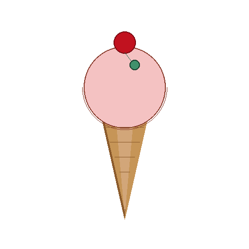
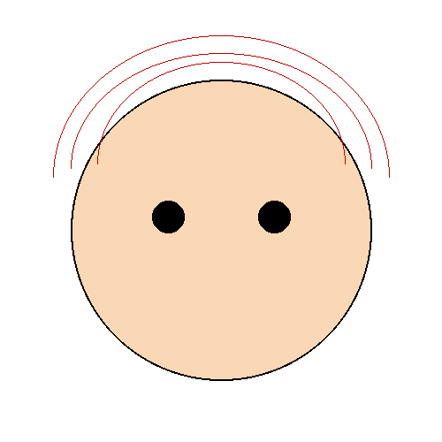

# Draw Shape AI Agent

An AI agent that turns plain-English prompts into drawings. Built with [Pydantic AI](https://ai.pydantic.dev/) and [Pillow](https://python-pillow.org/), the agent calls a set of drawing tools (rectangles, circles, lines, arcs, points, polygons) on a 500×500 canvas. It then saves the result as a PNG and writes an HTML page explaining the steps it took.

## Gallery

Each image below was drawn by the agent from a short text prompt.

| | | |
|:---:|:---:|:---:|
|  |  |  |
| City buildings during the day | Four mountain peaks with sun | Ice cream cone with a cherry |
|  |  |  |
| Round face, black eyes, red hair | Stars in the sky | Two trees |

## How it works

```
User prompt ──► Pydantic AI Agent (openai:gpt-5.2) ──► drawing tools ──► DrawingService (Pillow)
                                                          │
                                                          ├──► saveImage  → <name>.png
                                                          └──► writeHTML  → <name>.html (step-by-step explanation)
```

### Available tools

| Tool | Description |
|------|-------------|
| `drawRectangle` | Rectangle with fill and outline colors |
| `drawCircle` | Circle from a center point and radius |
| `drawLine` | Straight line between two points |
| `drawArc` | Arc inside a bounding box, between start and end angles |
| `drawPoints` | Individual points, for complex shapes |
| `drawPolygon` | Filled polygon from a list of points |
| `saveImage` | Saves the canvas as a PNG and opens it |
| `writeHTML` | Writes an HTML file describing the drawing steps |

## Project structure

```
draw_shape_ai_agent/
├── app.py                      # CLI entry point
├── agents/drawing_agent.py     # Pydantic AI agent setup and streaming
├── tools/drawing_tools.py      # Tool functions exposed to the agent
├── services/drawing_service.py # Pillow-based canvas operations
├── prompts/drawing_system_prompt.py
├── models/point.py             # Point model (x, y)
└── test_drawing_tools.py       # Manual test of the drawing tools
```

## Getting started

### Prerequisites

- Python 3.14+
- [Poetry](https://python-poetry.org/)
- An OpenAI API key

### Installation

```bash
git clone https://github.com/Anwesh43/draw-shape-ai-agent-.git
cd draw-shape-ai-agent-
poetry install
poetry add python-dotenv   # used to load the .env file
```

Create a `.env` file containing your API key:

```
OPENAI_API_KEY=your-api-key
```

### Usage

Run the app from inside the `draw_shape_ai_agent` package directory, passing your prompt as arguments:

```bash
cd draw_shape_ai_agent
poetry run python app.py "draw two trees with green leaves and brown trunks"
```

The agent streams its response to the terminal, saves the PNG, and writes an HTML file explaining the drawing.

To try the drawing tools without the agent:

```bash
cd draw_shape_ai_agent
poetry run python test_drawing_tools.py
```

This creates `test_drawing.png`.

## License

No license has been specified yet.
